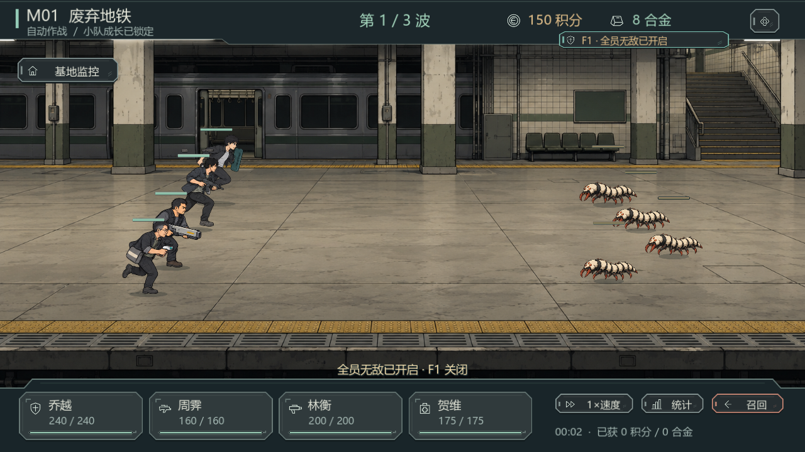
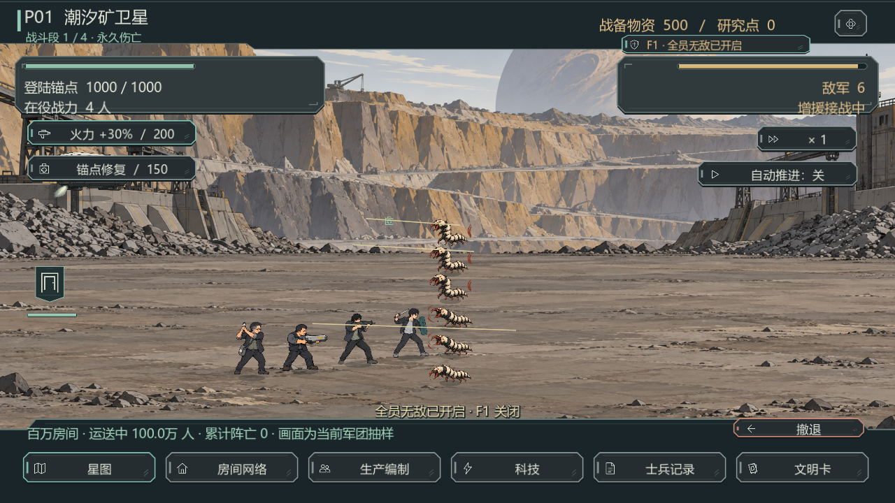

# F1 全员无敌 · 0.5.2

按 F1 开启，再按 F1 关闭。右上方以现有按钮纹理和盾牌图标持续显示「全员无敌已开启」，切换时有短提示。

- 第一阶段：四名队员免受全部普通、穿甲和技能伤害，攻击命中不消耗护盾。
- 星际战争：原四人、已部署的全部士兵及后续投送新人均免伤。
- 开关仅在本次程序运行中有效，切换场景、任务和历史模拟时继续生效；不写入存档，重新启动默认关闭。
- 无敌从开启时生效，不治疗旧伤、不复活已倒下或永久阵亡的人。敌人仍正常受伤，登陆锚点仍按原规则承伤。
- 长按只触发一次；暂停和弹窗内也可使用，不丢失输入框草稿和焦点。

实现分别在训练 `hit()`、战争 `damage_army()` 的伤害入口阻止友方受伤。模型向每次新建的战争模拟包装器传入同一会话开关，避免下一帧失效。

验证：26 项按键与战斗专项回归通过（包含独立发行包）；原模型 46 项通过；真实窗口 1280×720 大字模式 28 项通过（含两个战斗场景截图）；发行包资源与星际战争启动 362 项通过。专项回归已加入 `tools/test_reboot_full.ps1`。日志见 `docs/reboot-fixes/0.5.2/qa/`。

根目录 `启动游戏.cmd` 指向 `builds/InfiniteAnomaly-Reboot-Full-0.5.2/`。保留原存档及旧发行目录，退出旧游戏后重新启动即可。此版本已在本机构建；飞书现有 0.5.0 下载包不包含新功能。

