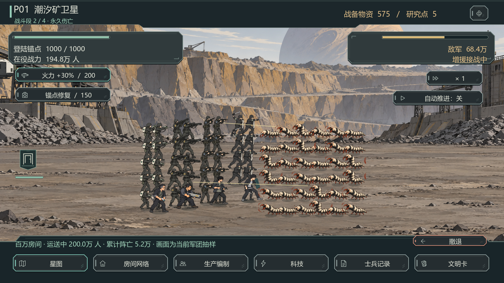
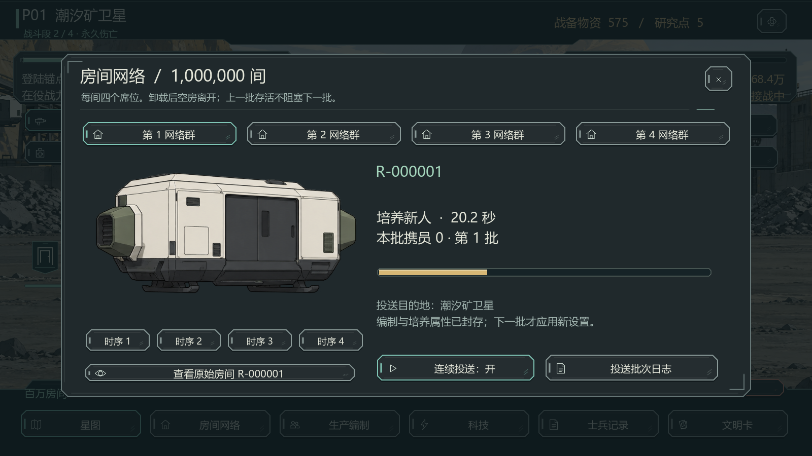
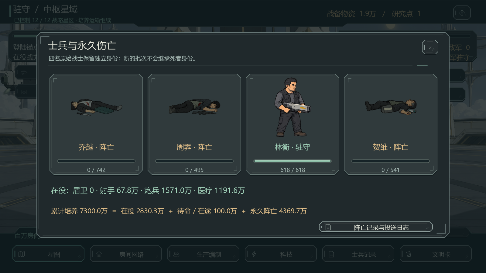

# 无限异常 0.5.0：后续任务与星际战争

2026-09-28。按用户“把后续任务和星际战争也做完”的要求，将 0.4.0 首章接成从新档到最终远征结局的完整可玩流程。当前入口为 `scenes/reboot/main.tscn`，启动器为根目录 `启动游戏.cmd`，独立发行目录为 `builds/InfiniteAnomaly-Reboot-Full/`。

## 完成范围

| 阶段 | 实际可玩的内容 |
| --- | --- |
| 四人房间 | 原前三任务及 M04 商场、M05 天台、M06 冷库、M07 泵站、M08 观测台、M09 通信塔、M10 零号试验场；每关独立背景、小怪、首领和机制 |
| 成长 | T1—T4，体质/武器/防具上限 5/10/15/20，Mk.01—04 制造、穿戴与分解；T3 第二能力槽的反射、再生、聚束、屏障 |
| 档案和故事 | 十任务普通/金/钻卡、后续队员对话、首次归来/天台/零号广播、毕业真相、两次交接确认、首次真实死亡及第4/8/12星区剧情 |
| 真实战争 | 原四人迁移为战士；百万房间循环、四类兵种、四个生产网络群、编制与投送控制、科技、火力与修复、撤退、驻守和自动推进 |
| 征服与结局 | 十二个具有独立背景、敌军特征及文明名称的星区，十二文明卡、结局、原四人永久档案、运输批次日志及历史模拟 |
| 交付 | 专用画面与按钮资源、3存档位、0.4.0迁移、校验/备份恢复、1280×720及1600×900、大字模式、独立Windows包 |

旧收容版、旧资源、0.4.0发行包和存档目录均保留。本版仍用 `user://reboot/`；`schema_version=2` 自动补齐 schema 1 的新任务与阶段字段。请勿再用0.4.0打开并覆盖升级后的存档。

## 从新档到结局

新建记录 → 四人醒来 → 整备与自动任务 → 召回升级 → M03后基地T2 → M06后基地T3与第二能力 → M08后Mk.03 → M10后基地T4/Mk.04 → 十项任务各8胜获得金卡 → 主动阅读毕业简报 → 两次确认交接 → 原四人登陆 → 百万房间持续投送 → 逐区征服、研究与调整编制 → 十二文明卡 → 远征结局。

任务波数为 **3、4、5、4、5、6、5、6、7、8**。每个任务完成全部波次才加一次胜场；已完成波次的积分/合金即时到账，失败或召回不重复发放。金卡8胜、钻卡25胜、十二战略枢纽等是本次落地数值，不声称为录音逐字指定。

M04群体、M05激光、M06厚甲、M07治疗、M08护盾、M09混合远程、M10轮换组合。普通激光为定点攻击，首领有全队扫射；避免六个普通单位叠加全队攻击导致毕业前不可通过。

## 房间与永久伤亡

一间房一次只有四个席位，完整状态为：**培养新人30秒 → 满员去程10秒 → 卸载2秒 → 空房返航10秒 → 下一批新人**。航行科技影响下一趟航程。自动投送关闭后，当前在途房间完成卸载和返航，新一批培养完成后待命；再次开启继续去程。

原四人从原房间 R-000001 的第0批迁入真实战场，携带当时成长、装备和能力。四人不成为教官，也没有死亡模板。新兵使用“房间范围/批次/席位”身份；原始房间之后的新人不会覆盖或复活原四人。上一批还活着，下一批照常培养与投送。空房不会带走地面战士。

百万房间由17个不重叠房间范围聚合模拟（原房间单列，其余按四个网络群和四组时序分段）。只有完成培养的四人进入待命/在途人数。每一步满足：

`累计培养完成 = 当前在役 + 待命/在途 + 永久阵亡`

部队按职业与培养时属性合并统计，旧兵不因科技升级被追溯改造；原四人单独记录。全军人数参加伤害和承伤计算，屏幕最多显示44友军/36敌军作为抽样，明确标注抽样，避免将百万房间等同于百万图形节点。

第一星区失守退回轨道，后续失守退回前一已占领星区。资源、已取得战果和永久伤亡保留；免费培养与驻守能重新集结。驻守治疗仅作用于活着的人。历史训练暂停战争/培养/运输，奖励留在训练档案，不覆盖真实战士。退出游戏不结算离线伤亡。

结局统计固定在最终胜利时刻；之后继续培养不会修改远征完成用时或当时累计投送数。战士档案在打开期间仍实时更新生命和阵亡状态。

## 画面与资源

本次新增36项PNG资源：22张场景（7张后续训练场景、12张星区、轨道和T3/T4房间），8套敌人，4套兵种，进阶装备图集和房间运输图集。原有角色、美术与69项SVG界面素材继续使用，按钮有正常/悬停/按下/禁用/焦点五状态。

PNG源图未经脚本重绘；图集通过透明度检测登记安全区域，修复首领顶部裁切，三个越界图集经图像编辑重新留出间隔。`tools/register_war_art.py` 只生成坐标和清单，不修改图像像素。来源与提示词记于 `art/reboot-war/generated-sources.json`。

实际Godot截图在 `art/reboot-war/captures/`，包含900p与720p、大字、后续任务、能力、交接、战争、编制、科技、伤亡、文明卡及结局。界面示例使用可控状态来检查布局；结局和最终阵亡页面读取完整战争推演的实际完成存档，不靠直接把进度写成12来证明通关。

## 验证结果

运行环境：Godot 4.7.1 mono / Windows，OpenGL兼容渲染、RTX 5060。所有测试使用工作区独立APPDATA，不改用户游戏存档。

| 检查 | 结果 |
| --- | --- |
| 原训练规则 | 46项断言通过 |
| 原界面回归 | 4443项素材/状态/边界断言通过 |
| 阶段与战争模型 | 114项断言通过，含人数守恒、空返、新批次、永久死亡、暂停与确定性续算 |
| 新界面 | 5760项素材/边界/动作断言通过，含打开档案时实时阵亡更新 |
| GUI鼠标事件 | 原流程35项 + 交接/战争55项通过；1280×720，包括遮罩、禁用态、编制、投送、撤退、历史和失败回退 |
| 跨进程存档 | 原战斗三进程12项 + 战争三进程11项通过，保存前后继续同一段时间得到相同战争状态 |
| 独立发行包 | 399个打包文件；362项配置、动画、背景与玩法载入检查通过 |
| 从零资源成长 | 295场任务、356次购买、36676.6模拟秒，十金毕业与接管成功；没有注入金币/等级/装备 |
| 完整战争 | 三组成熟编制 + 一组上述自然成长存档，均从第一星区到第十二星区及结局 |

“断言”不是对应数量的真人点击或玩家测试。图形截图是Godot实际渲染；输入验证是Godot鼠标事件命中，不是桌面物理鼠标录制。自动化战争策略会研究、补给和等兵力达到建议值，不代表无操作也能用相同时间通关。

四次战争推演的模拟用时为942.0、891.0、987.5、941.5秒；总永久阵亡为43,696,620、40,032,004、48,375,553、43,595,572。原四人的存活结果随编制变化。第一阶段约10.2小时的模拟成长和上述战争时间是此自动化购买策略的结果，并非真人实测时长或最终商业平衡目标。

汇总数据、经过检查的日志在 `docs/reboot-war/qa/`。本机沙箱Godot会提示无法读取系统根证书库；该提示不影响离线游戏，验收拒绝忽略脚本错误或缺失的成功标记。

## 复现与维护

1. `tools/test_reboot_full.ps1` 顺序执行从零成长、战争、界面、输入及跨进程存档，创建独立测试目录，遇到脚本错误或缺失成功标记立即停止。
2. `tools/build_reboot.ps1` 导入资源并打包0.5.0，明确输出到新目录；旧0.4.0目录不覆盖。
3. 用发行EXE加载发行PCK、外部 `tests/reboot/verify_campaign_pack.gd` 可复现独立包检查；测试脚本和作者文档不打进PCK。
4. `test_progression.gd` 先生成自然成长存档，`test_campaign.gd` 再读取该存档作为第四种完整战争输入。截图工具需要战争测试生成的完成存档。

新功能主要位于 `war_model.gd`（战争/生产）、`war_catalog.gd`（星区/科技）、`campaign_interface.gd`（新界面）、`war_world.gd`（战场表现）、`story_catalog.gd`（正式剧情）。原 `model.gd` 负责训练和阶段迁移。调整玩法时同步提示、配置、存档迁移与适用测试。

当前交付已覆盖完整玩法路径；未将自动推演当成长期真人平衡、所有显卡兼容或最终商业发行认证。后续主要依据试玩调整节奏、难度和动作观感。
