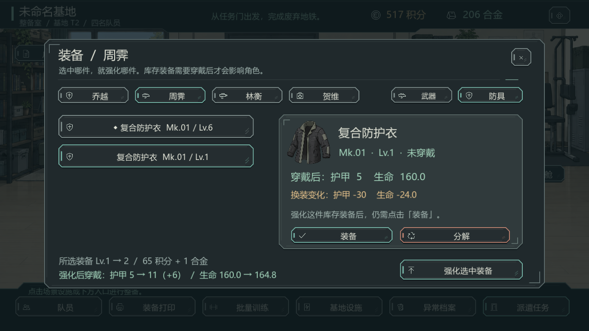
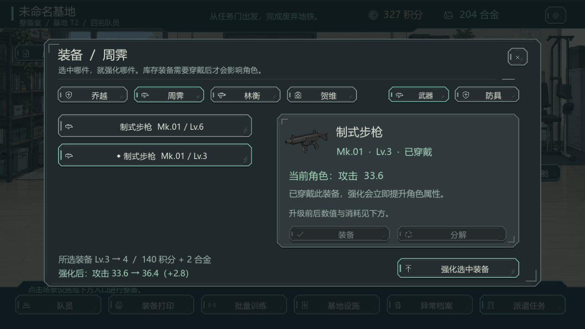

# 装备强化修复 0.5.1

2026-09-28。修复用户反馈：强化后装备没有变强，普通装备反而显示负数。

## 原因与复现

装备页选中库存 Lv.1 防具时，详情显示它相对已穿戴 Lv.6 防具的护甲差值 `-30`；底部强化按钮却始终作用于已穿戴装备。继续强化已穿戴装备后，库存装备的比较值会更负。它的自身等级没有降低，但选中项、比较值和操作目标不一致，使强化效果无法正确理解。

## 修复行为

- 强化、费用和等级上限全部绑定选中物品的 ID。库存装备也可强化，穿戴后才影响角色。
- 详情显示「当前角色」或「穿戴后」的实际属性，把「换装变化」独立标明。
- 底部显示所选等级、费用、强化前后属性；防具同时显示生命成长。
- 属性预览与实际战斗共用 `stats()` 计算，预览不修改库存。
- 强化后保留选中项；提示包含实际物品、等级变化和是否穿戴。提示移到窗口上方，避免遮住强化预览。
- 切换队员后清理不适用的选中项；写盘失败仍撤回本次强化与扣费。

没有调整战斗公式、装备成长系数、Mk 加成和资源价格，没有重置或转移既有装备等级。

## 验证

| 验证 | 结果 |
| --- | --- |
| 新增装备回归：四职业、武器与防具、库存与穿戴、价格、上限、无效目标、战斗锁定、装备切换、存档回读和写盘失败 | 239 项通过 |
| 原模型回归 | 46 项通过 |
| 原界面回归（含全部按钮材质与大小模式） | 4443 项通过 |
| 1280×720 大字模式真实窗口点击及四张截图 | 243 项通过，截图已检查 |
| 独立发行目录运行装备回归 | 239 项通过 |
| 独立发行包内容与星际战争启动验证 | 362 项通过 |

同一敌人使用实际 `hit()` 验证：已穿戴武器强化后伤害增加。截图复现的周霁防具 Lv.1→2，费用为 65 积分与 1 合金；穿戴后护甲 5→11，生命 160.0→164.8，原 Lv.6 防具保留。测试使用独立 APPDATA，没有访问玩家存档。

日志见 `docs/reboot-fixes/0.5.1/qa/`。`test_equipment.gd` 已加入 `tools/test_reboot_full.ps1` 的常规验证。

## 本机启动

根目录 `启动游戏.cmd` 已指向 `builds/InfiniteAnomaly-Reboot-Full-0.5.1/`。旧 0.5.0 目录保留，当前运行的旧进程未被关闭。保存退出后重新启动，继续原存档即可。

当前飞书中的 0.5.0 下载包不包含此修复；此记录对应本机 0.5.1 发行包。
